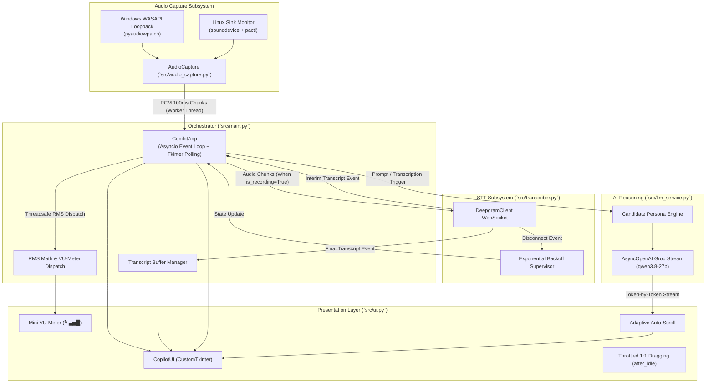

# Architecture Overview

**Analysis Date:** 2026-09-15

## Architectural Pattern
The application follows an **Asynchronous Event-Driven Pipeline** coordinating native system audio capture, real-time cloud STT streaming, LLM response generation, and a hardware-accelerated desktop overlay.

## Architectural Layers & Responsibilities

### 1. Audio Capture Layer (`src/audio_capture.py`)
- Isolates platform-specific audio driver intricacies (WASAPI loopback on Windows vs PulseAudio/PipeWire sink monitors on Linux).
- Delivers normalized 16kHz, 16-bit mono PCM chunks (100ms buffer size) via non-blocking callbacks to the orchestrator.
- Thread isolation: Stream callbacks execute in PortAudio/OS threads; data is handed off to the main loop via `loop.call_soon_threadsafe`.

### 2. Live Transcription Layer (`src/transcriber.py`)
- Manages persistent WebSocket lifecycles with Deepgram `nova-2` pt-BR.
- Splits hypotheses into interim updates (live preview) and finalized sentences (committed to transcription memory).
- Features autonomous fault detection and recovery through `_reconnect_loop()`, preventing silent pipeline death on network drops.

### 3. AI Reasoning & Inference Layer (`src/llm_service.py`)
- Injects candidate professional background and interview delivery constraints.
- Emits an asynchronous generator (`stream_response`) that streams tokens to avoid perception of latency during real-time interviews.

### 4. Presentation & Interaction Layer (`src/ui.py`)
- High-contrast HUD overlay built on `CustomTkinter` and native `tkinter`.
- Designed for low visual footprint with dynamic opacity profiles (75%, 85%, 92%, 100%).
- Multi-monitor intelligent placement (top-center under webcam, top-right, top-left, center) querying `xrandr`.
- Zero-lag window movement via `after_idle` scheduling and screen-root mouse tracking (`event.x_root`).
- User-respecting auto-scroll: tokens auto-scroll to the bottom unless the user scrolls up to review prior sentences (`yview()[1] < 0.98`).

### 5. Application Orchestration Layer (`src/main.py`)
- Houses `CopilotApp`, binding the event loops and inter-component signals.
- Drives the cooperative event loop: `self.ui.update()` runs every ~10ms (`await asyncio.sleep(0.01)`), enabling smooth 60 FPS UI rendering without threading overhead or GIL contention.
- Controls state transitions (`is_recording`, `transcript_buffer`, canceling in-flight LLM tasks upon new questions).
