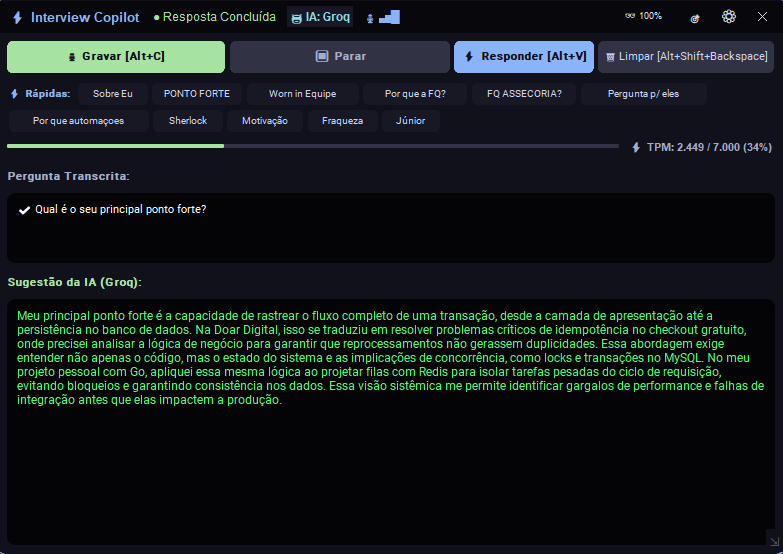
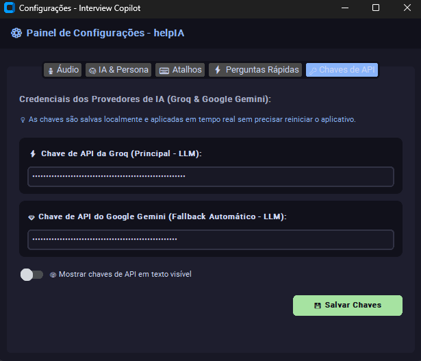

# ⚡ Interview Copilot (`helpIA`)

<div align="center">


**Assistente inteligente de entrevistas técnicas em tempo real.**
Captura o áudio interno da chamada, transcreve com precisão cirúrgica via **Deepgram WebSocket (`nova-2`)** e gera respostas estruturadas em milissegundos usando **Groq Cloud** + **Google Gemini Fallback** em uma interface **HUD Overlay** furtiva e sempre no topo.

<br>


<p><em>👆 <strong>HUD Principal do Interview Copilot:</strong> Janela flutuante semi-transparente com controles de gravação, medidor de áudio ao vivo, barra de perguntas rápidas (Quick Prompts), rastreador de tokens (TPM) e áreas de transcrição e resposta em streaming.</em></p>

</div>

---

## 📸 Tour Visual pela Interface (Telas & Funcionalidades)

Abaixo você confere em detalhes cada tela do **Interview Copilot (`helpIA`)** e o que cada componente faz:

### 1. 🖥️ HUD Overlay Principal 

<div align="center">
  
</div>

> **Legenda & O que esta tela faz:**
> Esta é a janela principal de operação durante a entrevista. Ela permanece sempre no topo (`Always on Top`) e não possui bordas pesadas do sistema operacional, podendo ficar posicionada logo abaixo da sua webcam.
>
> - **Barra Superior Inteligente (Header)**:
>   - `● Pronto` / `● Ouvindo Pergunta...`: Badge de status em tempo real da sessão e da conexão WebSocket.
>   - `🤖 IA: Groq` / `✨ IA: Gemini`: Indica qual motor de IA está ativo no momento (troca sozinho caso o limite de tokens da Groq seja atingido).
>   - `🎙 ▃▅█` (**Mini VU-Meter**): Medidor gráfico de volume em tempo real que oscila quando o áudio do recrutador está sendo captado.
>   - `👓 100%` / `92%` / `75%` / `85%`: Botão (atalho `F10`) para alternar instantaneamente a transparência da janela (*Stealth Mode*).
>   - `🎯`: Botão (atalho `F8`) para ancorar rapidamente a janela em 4 posições estratégicas da tela (`Topo-Centro`, `Topo-Direita`, `Topo-Esquerda` ou `Centro`).
>   - `⚙`: Abre o Painel de Configurações (`F12`).
> - **Barra de Ação Principal**:
>   - `🎙 Gravar`: Inicia a captura e envio do áudio da chamada para transcrição (exibindo dinamicamente o seu atalho configurado, ex: `[Alt+C]` ou `[Ctrl+Espaço]`).
>   - `⏹ Parar`: Pausa a captura de áudio sem disparar a IA.
>   - `⚡ Responder`: Finaliza a fala capturada e dispara imediatamente a geração da resposta em streaming na IA.
>   - `🗑 Limpar`: Reseta a transcrição, limpa a resposta atual e esvazia os buffers para a próxima pergunta.
> - **Barra `⚡ Rápidas:` (Quick Prompts)**: Grade de botões dinâmicos com *auto-wrap* (quebra de linha automática) como *Sobre Eu*, *PONTO FORTE*, *Sherlock*, *Motivação*, *Júnior*, etc. Ao clicar em qualquer botão, a pergunta correspondente é enviada na hora para a IA sem precisar gravar áudio!
> - **Medidor `⚡ TPM` (Tokens Por Minuto)**: Barra de progresso que monitora em tempo real o seu consumo de tokens na janela deslizante de 60 segundos da Groq (ex: `0 / 7.000 (0%)`).
> - **Caixas de `Pergunta Transcrita` e `Sugestão da IA`**: Exibe o que o recrutador falou (ou permite que você digite/edite manualmente) e renderiza token a token a resposta pronta em primeira pessoa para você ler com naturalidade. No canto inferior direito (`⇲`), há uma alça para **redimensionar livremente** o tamanho do HUD.

---

### 2. ⚡ Resposta Gerada em Tempo Real 

<div align="center">
  
</div>

> **Legenda & O que esta tela faz:**
> Exemplo prático da aplicação em ação durante a entrevista com o status `● Resposta Concluída`.
>
> - **Pergunta Capturada e Confirmada (`✔`)**: Na área **Pergunta Transcrita**, o texto finalizado pelo recrutador (ou disparado pelo atalho de pergunta rápida) é marcado com um ícone de confirmação (`✔ Qual é o seu principal ponto forte?`).
> - **Monitoramento de Tokens Ativo (`TPM: 2.449 / 7.000 (34%)`)**: A barra de TPM avança em verde proporcionalmente aos tokens gerados na requisição, demonstrando o controle rigoroso da cota de 60 segundos da Groq para garantir que você nunca seja bloqueado por *rate limit*.
> - **Sugestão da IA em Primeira Pessoa**: Na área **Sugestão da IA (Groq)**, o modelo estruturou uma resposta técnica impecável, sem enrolação, contextualizada com a vivência real do desenvolvedor (citando projetos reais como *Doar Digital*, desafios de idempotência em checkout, concorrência/locks no *MySQL* e filas em *Redis*). O texto é exibido em verde suave de alto contraste (`#50FA7B` / `#A6E3A1`), ideal para leitura imediata sem desviar o foco da câmera.

---

### 3. 🎙️ Painel de Configurações — Aba `Áudio` 

<div align="center">
  
</div>

> **Legenda & O que esta tela faz:**
> Central de controle e diagnóstico de captação sonora do sistema.
>
> - **Placa de Som / Dispositivo de Entrada**: Permite manter no modo inteligente `Padrão do Sistema` (que monitora todas as saídas WASAPI no Windows e detecta sozinho onde o Google Meet/Zoom está tocando) ou selecionar manualmente um dispositivo `[Loopback]` específico. Possui botões para **🔄 Atualizar Dispositivos** e **💾 Salvar Dispositivo**.
> - **Medidor de Nível em Tempo Real (Teste de Captação)**: Um **VU-Meter** com barra de progresso azul e indicador de barras verdes (`🎙 ▃▅·`) que mostra ao vivo a intensidade do áudio capturado — perfeito para você testar o som antes da entrevista começar.
> - **Switch `🎙 Usar pré-roll ao iniciar gravação`**: Ativa ou desativa o buffer circular de **5 segundos**. Quando ativado, o sistema guarda continuamente os últimos 5 segundos de áudio; assim, mesmo que você aperte "Gravar" alguns segundos *depois* que o recrutador começou a falar, o começo da frase não é perdido!
> - **Switch `🎯 Detecção automática de perguntas`**: Ativa o motor heurístico que identifica perguntas na transcrição e acende um alerta dourado (`🎯 Pergunta Detectada!`) no HUD principal.

---

### 4. 🧠 Painel de Configurações — Aba `IA & Persona` 

<div align="center">
  
</div>

> **Legenda & O que esta tela faz:**
> Define o "cérebro" da IA, o formato das respostas e todo o currículo/contexto real do candidato.
>
> - **Seletor de `Estilo de Resposta da IA`**: Permite alternar com um clique entre 3 modos de estruturação:
>   1. `⚡ Direta (3-4 frases)`: Respostas curtas, objetivas e rápidas de falar.
>   2. `🔬 Técnica (Aprofundada)`: Respostas de 5 a 7 frases abordando arquitetura de software, *design patterns*, banco de dados e *trade-offs*.
>   3. `⭐ Método STAR`: Estrutura a resposta estritamente em **S**ituação, **T**arefa, **A**ção e **R**esultado.
> - **Editor de `Contexto & Perfil do Candidato (System Prompt)`**: Caixa de texto completa onde você insere seu currículo, tecnologias que domina, projetos reais e regras de comportamento (ex: *"Gere a resposta EXATA em primeira pessoa"*, *"Nunca invente experiências ou métricas"*).
> - **Botões `↺ Restaurar Padrão` e `💾 Salvar IA & Persona`**: Permite voltar ao prompt original de fábrica a qualquer momento ou salvar seu perfil customizado para uso imediato (sem precisar reiniciar o programa).

---

### 5. ⌨️ Painel de Configurações — Aba `Atalhos` 

<div align="center">
  
</div>

> **Legenda & O que esta tela faz:**
> Permite personalizar 100% dos atalhos globais de teclado que funcionam mesmo quando o `helpIA` está em segundo plano (com foco no navegador, Google Meet, Teams ou VS Code).
>
> - **Captura Interativa de Teclas**: Basta clicar em qualquer um dos 6 campos (`Gravar / Parar Pergunta`, `Responder Agora`, `Limpar Tela / Reset`, `Alternar Posição HUD`, `Alternar Opacidade`, `Abrir Configurações`) e pressionar a combinação desejada no seu teclado (como `Alt + C`, `Alt + V`, `Alt + Shift + Backspace`, `F8`, `F10`, `F12`).
> - **Sincronização Instantânea**: Ao clicar em **💾 Salvar Atalhos**, o listener global (`pynput`) é atualizado na hora e os rótulos dos botões lá na tela principal do HUD passam a exibir automaticamente os seus novos atalhos!

---

### 6. ⚡ Painel de Configurações — Aba `Perguntas Rápidas` 

<div align="center">
  
</div>

> **Legenda & O que esta tela faz:**
> Gerencia os botões de disparo rápido (*Quick Prompts*) exibidos no HUD principal para aquelas perguntas clássicas que todo recrutador faz.
>
> - **Formato Simples (`Nome do Botão | Pergunta`)**: Cada linha do editor vira automaticamente um botão no HUD principal. O texto antes da barra vertical `|` define o nome curto do botão, e o texto depois da barra é a pergunta completa enviada para a IA:
>   - `Sobre Eu | Fale mais sobre você e sua trajetória profissional`
>   - `PONTO FORTE | Qual é o seu principal ponto forte?`
>   - `Sherlock | Me conte sobre o projeto Sherlock/WhatsMiau que você desenvolveu`
>   - `Motivação | Por que você quer trabalhar na empresa?`
> - **Atualização Dinâmica**: Ao clicar em **💾 Salvar Perguntas**, o HUD principal reconstrói imediatamente a grade de botões organizando tudo em linhas automáticas.

---

### 7. 🔑 Painel de Configurações — Aba `Chaves de API` 

<div align="center">
  
</div>

> **Legenda & O que esta tela faz:**
> Facilidade total para o usuário configurar suas credenciais sem precisar abrir arquivos de código ou editar o `.env` manualmente!
>
> - **Chave de API da Groq (Principal - LLM)**: Campo protegido para inserir sua chave da Groq Cloud (`gsk_...`), responsável pelas respostas de altíssima velocidade.
> - **Chave de API do Google Gemini (Fallback Automático - LLM)**: Campo protegido para inserir sua chave do Google AI Studio (`AIzaSy...`), garantindo contingência automática quando os limites de tokens da Groq forem atingidos.
> - **Switch `👁 Mostrar chaves de API em texto visível`**: Permite alternar entre visualização com máscara (`••••••••••`) e texto legível para conferir o preenchimento sem erros.
> - **Aplicação Imediata em Tempo Real**: Ao clicar em **💾 Salvar Chaves**, as credenciais são salvas localmente e recarregadas instantaneamente pelo aplicativo, sem necessidade de reiniciar o programa.

---

## 🌟 Resumo da Arquitetura Técnica

| Camada | Tecnologia | Papel no Sistema |
| :--- | :--- | :--- |
| **Linguagem** | Python 3.10+ | Núcleo da aplicação e concorrência `asyncio` + `threading` |
| **Áudio (Windows)** | `PyAudioWPatch` (WASAPI) | Captura loopback nativa + stream keep-alive + auto-switch |
| **Áudio (Linux)** | `sounddevice` + `pactl` | Captura via monitor de saída do PipeWire / PulseAudio |
| **Processamento DSP** | `NumPy` | Cálculo de volume RMS (VU-Meter), downmix mono e reamostragem 16kHz |
| **Speech-to-Text** | `deepgram-sdk` (`nova-2`) | Transcrição contínua via WebSocket com vocabulário técnico |
| **LLM Primário** | `openai` (SDK p/ Groq API) | Streaming de respostas em ultra-baixa latência |
| **LLM Fallback** | `google-generativeai` (Gemini) | Contingência proativa (90% TPM) e reativa contra *rate limits* |
| **Interface Gráfica** | `CustomTkinter` + `Tkinter` | HUD Overlay flutuante e janela modal de configurações |
| **Atalhos Globais** | `pynput` | Captura de teclas em nível de sistema operacional |

---

## 📂 Estrutura do Projeto

```plaintext
helpIA/
├── .env.example              # Modelo das variáveis de ambiente e chaves de API
├── helpia_config.json        # Configurações persistidas do usuário (gerado automaticamente)
├── requirements.txt          # Dependências Python multiplataforma (Windows e Linux)
├── README.md                 # Documentação completa do projeto
├── src/
│   ├── main.py               # Orquestrador principal (CopilotApp) e loop asyncio + UI
│   ├── audio_capture.py      # Captura de áudio multiplataforma (WASAPI / PulseAudio)
│   ├── audio_buffer.py       # Buffer circular thread-safe de Pré-Roll (PreRollAudioBuffer)
│   ├── transcriber.py        # Cliente WebSocket Deepgram com reconexão e keywords
│   ├── llm_service.py        # Integração Groq + Gemini Fallback, estilos e TokenTracker
│   ├── question_detector.py  # Motor heurístico de identificação de perguntas (PT/EN)
│   ├── ui.py                 # Interface HUD Overlay principal (CopilotUI)
│   ├── settings_window.py    # Painel modal de configurações com 4 abas (SettingsWindow)
│   ├── config_manager.py     # Gerenciador de estado e persistência (helpia_config.json)
│   ├── hotkey_manager.py     # Listener global de atalhos de teclado via pynput
│   ├── diagnostic.py         # Ferramenta CLI de diagnóstico de áudio e Deepgram
│   └── public/
│       └── imagens/          # Capturas de tela da interface para documentação
└── tests/                    # Suíte de testes automatizados (pytest / unittest)
```

---

## ⚙️ Pré-requisitos e Instalação

### 1. Preparação do Sistema Operacional

#### 🪟 No Windows (Windows 10 / 11)
Não é necessária nenhuma instalação de driver externo (como VB-Cable). O projeto instala automaticamente o `PyAudioWPatch`, que acessa o **WASAPI Loopback** nativo do Windows.
- Certifique-se apenas de ter o **Python 3.10+** instalado (com a opção *"Add Python to PATH"* e suporte a *tcl/tk* marcados no instalador).

#### 🐧 No Linux (Ubuntu / Pop!_OS / Debian / Mint)
Instale os cabeçalhos do PortAudio, suporte ao Tkinter e utilitários do PulseAudio/PipeWire:
```bash
sudo apt update
sudo apt install -y python3-pyaudio portaudio19-dev python3-tk pulseaudio-utils libportaudio2
```

---

### 2. Clonar o Repositório e Instalar as Dependências

```bash
git clone https://github.com/seu-usuario/helpIA.git
cd helpIA
```

Você pode instalar as dependências diretamente no seu Python ou dentro de um ambiente virtual (`venv`):

**Opção A — Instalação Direta (Windows PowerShell):**
```powershell
pip install --upgrade pip
pip install -r requirements.txt
```

**Opção B — Usando Ambiente Virtual (`venv`):**
```powershell
# Windows (PowerShell)
python -m venv venv
.\venv\Scripts\Activate.ps1
pip install -r requirements.txt
```
```bash
# Linux (Bash/Zsh)
python3 -m venv venv
source venv/bin/activate
pip install -r requirements.txt
```

---

## 🔐 Configuração das Chaves de API (Interface Gráfica ou `.env`)

Você pode configurar suas chaves de API de **duas formas super fáceis**:

### Opção 1: Diretamente pela Interface Gráfica (Recomendado) 🚀
Abra o aplicativo, clique no ícone **`⚙`** (ou pressione **`F12`**) e acesse a aba **`🔑 Chaves de API`** (conforme visto na foto acima). Lá você digita sua chave da **Groq** e do **Google Gemini** e clica em **💾 Salvar Chaves**. Elas são salvas e aplicadas em tempo real!

---

### Opção 2: Pelo arquivo `.env`

Crie um arquivo `.env` na raiz do projeto copiando o modelo `.env.example`:

**Windows (PowerShell):**
```powershell
Copy-Item .env.example .env
```

**Linux:**
```bash
cp .env.example .env
```

Abra o arquivo `.env` e preencha suas credenciais. Abaixo estão **todas as variáveis suportadas** (obrigatórias e opcionais):

```env
# ====================================================================
# 1. CHAVES OBRIGATÓRIAS
# ====================================================================
# Chave da Deepgram para transcrição de voz em tempo real (Speech-to-Text)
# Obtenha gratuitamente ($200 de crédito) em: https://console.deepgram.com/
DEEPGRAM_API_KEY=sua_chave_deepgram_aqui

# Chave da Groq Cloud para geração de respostas ultra-rápidas (LLM Primário)
# Obtenha gratuitamente em: https://console.groq.com/keys
GROQ_API_KEY=sua_chave_groq_aqui

# ====================================================================
# 2. CHAVES E PARÂMETROS OPCIONAIS (ALTAMENTE RECOMENDADOS)
# ====================================================================
# Chave do Google Gemini para Fallback Automático quando o limite de TPM da Groq atingir 90%
# Obtenha gratuitamente em: https://aistudio.google.com/app/apikey
GEMINI_API_KEY=sua_chave_gemini_aqui

# Modelo da Groq a ser utilizado (Padrão: qwen/qwen3.8-27b)
# Outras opções: llama-3.3-70b-versatile, llama3-8b-8192, mixtral-8x7b-32768
GROQ_MODEL=qwen/qwen3.8-27b

# Limite customizado de Tokens Por Minuto (TPM) da sua conta Groq (Padrão: 7000 para Qwen)
GROQ_TPM_LIMIT=7000

# Modelo do Gemini utilizado no fallback (Padrão: gemini-flash-lite-latest)
GEMINI_MODEL=gemini-flash-lite-latest

# [Apenas Linux] Forçar manualmente um monitor do PulseAudio/PipeWire caso deseje
# PULSE_SOURCE=alsa_output.pci-0000_00_1f.3.analog-stereo.monitor
```

---

## ▶️ Como Executar e Usar

No terminal, dentro da pasta `helpIA`, execute:

```powershell
python src\main.py
```

### 🎮 Passo a Passo durante a Entrevista

1. **Ancore o HUD perto da Webcam (`F8`)**:
   - Pressione **`F8`** para posicionar o overlay no **Topo-Centro** da tela. Assim você lê as respostas olhando diretamente para a câmera.
   - Ajuste a opacidade com **`F10`** (`92%`, `100%`, `75%`, `85%`).
2. **Grave a Pergunta do Recrutador (`Ctrl + Espaço` ou `Alt + C`)**:
   - Pressione o seu atalho de gravação quando o entrevistador fizer uma pergunta.
   - Graças ao **Pré-Roll**, se você ativar essa opção na aba Áudio, mesmo que aperte o botão até 5 segundos atrasado, o início da pergunta será recuperado e transcrito!
3. **Dispare a Resposta (`Ctrl + Enter` ou `Alt + V`)**:
   - Pressione o atalho de resposta (ou clique em um dos botões da barra **`⚡ Rápidas:`**).
   - A resposta surgirá instantaneamente em primeira pessoa na caixa inferior.
4. **Limpe a Sessão (`Esc` ou `Alt + Shift + Backspace`)**:
   - Limpa a transcrição e a resposta atual, deixando o HUD pronto para a próxima pergunta.

---

## ⌨️ Atalhos Globais de Teclado

Todos os atalhos funcionam em segundo plano (mesmo com o navegador em foco) e podem ser customizados na aba **⌨ Atalhos (`F12`)**:

| Ação | Atalho Padrão de Fábrica | Exemplo Customizado (Fotos) | Botão no HUD |
| :--- | :---: | :---: | :---: |
| **Iniciar / Parar Gravação** | `Ctrl + Espaço` (ou `F9`) | `Alt + C` | `🎙 Gravar` / `⏹ Parar` |
| **Responder Agora (Disparar IA)** | `Ctrl + Enter` | `Alt + V` | `⚡ Responder` |
| **Limpar Sessão / Resetar** | `Esc` (ou `Ctrl + Backspace`) | `Alt + Shift + Backspace` | `🗑 Limpar` |
| **Alternar Posição na Tela (Presets)** | `F8` | `F8` | `🎯` |
| **Alternar Opacidade (Stealth Mode)** | `F10` | `F10` | `👓 100%` |
| **Abrir Painel de Configurações** | `F12` | `F12` | `⚙` |

---

## ⚙️ Configurações Avançadas (`helpia_config.json`)

Todas as opções alteradas no painel visual (`F12`) são salvas automaticamente no arquivo `helpia_config.json` na raiz do projeto. Você também pode editá-lo manualmente para ajustar parâmetros extras de engenharia:

```json
{
  "audio": {
    "device_index": null,
    "device_name": "Padrão do Sistema",
    "pre_roll_seconds": 5.0,
    "pre_roll_enabled": true
  },
  "transcription": {
    "language": "pt-BR",
    "endpointing_ms": 350,
    "custom_keywords": [
      "NestJS:3",
      "Supabase:2",
      "n8n:3"
    ]
  },
  "llm": {
    "response_style": "tecnica",
    "custom_persona": null,
    "model": "qwen/qwen3.8-27b"
  },
  "question_detection": {
    "enabled": true,
    "auto_trigger_on_silence": false,
    "silence_delay_ms": 1200
  }
}
```

- **`audio.pre_roll_seconds`**: Define quantos segundos de áudio passados ficam retidos no buffer circular (padrão: `5.0`).
- **`transcription.language`**: Idioma da entrevista no Deepgram (`"pt-BR"`, `"en-US"`, `"es"`).
- **`transcription.custom_keywords`**: Termos técnicos adicionais com peso de reforço (`"Termo:Peso"`) somados ao vocabulário padrão para evitar erros de transcrição.
- **`question_detection.auto_trigger_on_silence`**: Se alterado para `true`, o sistema dispara a resposta da IA **sozinho** após detectar uma pergunta seguida de `1200ms` de silêncio, sem precisar apertar tecla nenhuma!

---

## 🔍 Diagnóstico e Solução de Problemas

Caso queira testar o pipeline de áudio e a conexão com a Deepgram isoladamente no terminal, execute (com um vídeo ou áudio tocando no PC):

```powershell
python src\diagnostic.py
```

Para rodar a suíte de testes automatizados do projeto:

```powershell
python -m unittest discover -s tests -p "test_*.py" -v
```

---

## 🛡️ Licença

Este projeto é destinado a uso pessoal, estudo de arquitetura assíncrona em tempo real e preparação para entrevistas técnicas.
